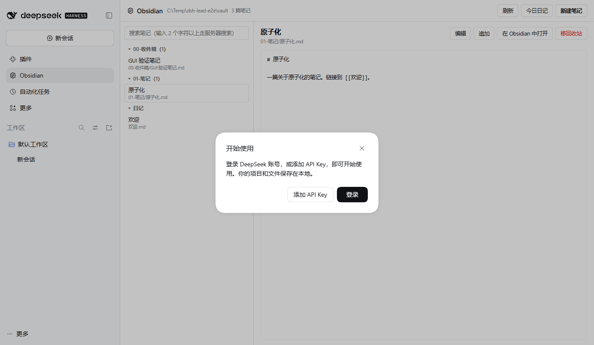

# dsh-plugin-obsidian

**把 Obsidian 仓库直接接进 DeepSeek Harness**：agent 可以用 10 个 `obsidian_*` 工具**直接添加和管理**笔记，DSH 侧栏里多出一个 **Obsidian 面板**可以浏览 / 搜索 / 新建 / 编辑 / 追加 / 移到回收站 / 打开今日日记 / 在 Obsidian 中打开。

不依赖任何 Obsidian 社区插件（本仓库甚至没有安装社区插件），直接读写 vault 里的 Markdown 文件；Obsidian 自己会热更新外部改动。



---

## 它解决什么问题

「把这段记到 Obsidian 里」以前要：切到 Obsidian → 想放哪个文件夹 → 新建笔记 → 起名 → 粘贴 → 补标签。现在：

- 在 DSH 对话里说一句「**把刚才的结论记成一篇原子笔记，放到 01-笔记，打上 #方法 标签**」，agent 直接写进去；
- 或者点侧栏 **Obsidian**，在面板里浏览、搜索、编辑、新建，改完保存；
- 想对照原文就点「在 Obsidian 中打开」，用 `obsidian://` 把笔记拉起来。

---

## 安装

**环境**：Windows + DeepSeek Harness 桌面版（实测 0.2.1-rc.5，插件零运行时依赖）。

**一键方式**：双击 `install.cmd`（内部优先 pwsh 7，没有就用 Windows PowerShell 5.1，两者都测过）。

```powershell
install.cmd                                   # 装进默认的 desktop profile
install.ps1 -ProfileDir <路径>                 # 装进别的 profile
install.ps1 -WhatIf                           # 只看计划，不写任何文件
```

它做三件事，全部幂等：

1. 把 `"dsh-plugin-obsidian": "link:<本仓库绝对路径>"` 写进 profile 的 `dependencies`
   （用 `link:` 而不是 `file:`：`file:` 会被 pnpm 硬链接复制，之后改源码进不去）；
2. 把包名追加进 `dsh.profile.bundles`（包自带 `cordis.patch.yml`，会插入自己的行）；
3. 用 DSH 自带的 pnpm 安装，在 `node_modules` 里建一个指向本仓库的 Junction。

安全约定（照抄 `dsh-plugin-zero-friction` 踩过的坑）：

- 改 profile 前先备份到 `<ProfileDir>\.install-backup\<时间戳>\`；
- 写 JSON **无 BOM**（PowerShell 5.1 的 `Set-Content -Encoding UTF8` 会写 BOM，带 BOM 的 JSON 会让 DSH 起不来）；
- 写后**读回自校验**（无 BOM + 可解析 + 依赖与 bundle 各一项），失败立刻用备份回滚并非 0 退出；
- `-WhatIf/-Check` 不写任何文件。

> 桌面 profile 被 Electron 独占，`dsh plugin --profile desktop add` 会被 CLI 拒绝，所以走「改 profile 文件 + 自带 pnpm」这条路；web profile 可以直接 `dsh plugin --profile web add <路径>`。

### 启用

装完**刷新页面（Ctrl+R）**；侧栏没出现「Obsidian」就**重启 DeepSeek Harness**。
（客户端模块名单是宿主在启动时组合进 `window.__DSH_BOOT__` 的；插件行热重载不一定触发重组，所以刷新优先、重启兜底。）

### 卸载

```powershell
uninstall.cmd                                  # 移除依赖 + bundle 项（保留备份）
uninstall.ps1 -RemoveNodeModules               # 连 node_modules 里的链接一起清
```

---

## 怎么用

### 1. Agent 工具（模型侧）

插件注册了 10 个工具，任何会话里直接说需求即可：

| 工具 | 用途 |
|---|---|
| `obsidian_status` | 仓库信息：路径、笔记数、目录数、日记配置来源 |
| `obsidian_list` | 列目录/笔记（`dir`、`depth`、`limit`） |
| `obsidian_read` | 读一篇笔记（frontmatter、标签、双链、正文、大小） |
| `obsidian_search` | 全文/标题/标签/路径搜索，带行号与片段 |
| `obsidian_write` | 新建 / 覆盖 / 追加 / 前插，可带 frontmatter 与标签 |
| `obsidian_manage` | `move` 移动改名、`trash` 移到 `.trash`（`hard:true` 才真删） |
| `obsidian_daily` | 今日/指定日期的日记：读、追加、创建（按模板） |
| `obsidian_tags` | 标签聚合（frontmatter + 正文内联 `#tag`） |
| `obsidian_links` | 出链 / 反链 / 未解析链接 |
| `obsidian_open` | 用 `obsidian://` 在 Obsidian 里打开 |

例子：

> 「把这份会议纪要记进 Obsidian：放到 `00-收件箱/2026-11-20 需求评审`，标签 `项目/DSH`、`状态/草稿`，正文按三段写。」

> 「在 `01-笔记/为什么笔记要原子化` 末尾追加一段，驳一下我上周那版观点。」

> 「今天日记里加一条：插件装好了，面板能开。」

### 2. Obsidian 面板（人侧）

侧栏 **Obsidian** → 主区域：

- 左侧：搜索框（本地过滤 + 输入 ≥2 字符自动走服务器搜索）、可折叠目录树；
- 右侧：笔记标题/路径/标签 + 正文（等宽预览）、`编辑` / `追加` / `在 Obsidian 中打开` / `移回收站`（二次确认）；
- 顶栏：仓库路径与笔记数、`刷新`、`今日日记`、`新建笔记`（路径 / 标题 / 正文 / 标签）。

所有失败都会显示为可读错误 + 重试，不会白屏。

### 3. HTTP API（脚本/外部）

面板用的是同一套接口（同源校验，`/dsh-obsidian/api/*`）：
`health`、`status`、`tree`、`note`(GET/POST)、`search`、`manage`、`daily`、`tags`、`links`、`open`。
`GET /dsh-obsidian/api/health` 会如实报告 `toolsRegistered`（宿主工具服务里真正注册成功的工具名），这是「插件真的挂上了」的自检口。

### 4. 仓库位置

优先级：**profile 行 config 的 `vaultPath`** > 环境变量 **`DSH_OBSIDIAN_VAULT`** > 自动发现
（读 `%APPDATA%\obsidian\obsidian.json`，取 `open: true` 的仓库）。
本机自动发现结果就是 `C:\Users\谢安豪\Documents\Obsidian Vault`，通常不需要配置。

日记配置自动读 `.obsidian/daily-notes.json`（folder / format / template），缺省为仓库根、`YYYY-MM-DD`。

---

## 安全与写入约定

- **路径沙箱**：只接受 vault 相对路径；拒绝绝对路径、盘符、`..`、以 `.` 开头的段（保护 `.obsidian/`）、Windows 非法字符；解析后再用 `realpath` 校验仍在仓库根内，**防 Junction/软链接逃逸**。
- **原子写**：同目录临时文件 + `rename`，UTF-8 **无 BOM**、LF；覆盖前自动备份到 `<DSH_HOME>/obsidian-backups/<时间戳>/<相对路径>`。
- **删除 = 回收站**：`obsidian_manage trash` 移到 `<vault>/.trash/<时间戳>-<文件名>`；只有显式 `hard:true` 才真删。
- **同源围栏**：API 拒绝 `sec-fetch-site: cross-site` 与 Origin 与 Host 不一致的请求（跨站 403）。

---

## 验证记录

不是「我觉得能跑」，是实际执行过的。全部在 Windows 10/11、Node v24.21.0、DSH 0.2.1-rc.5 上跑：

### 离线回归（一条命令）

```powershell
node tools/verify.cjs
```

| 套件 | 结果 |
|---|---|
| `test-vault.cjs`（vault 引擎） | 28 passed, 0 failed |
| `test-tools.cjs`（10 个工具定义） | 19 passed, 0 failed |
| `test-api.cjs`（路由/同源/错误码） | 15 passed, 0 failed |
| `check-client.cjs`（浏览器半区契约 + 三态渲染 + 交互 + 非空洞变异） | 45 passed, 0 failed |
| `harness-host.cjs`（真 `apply()` + 真 HTTP server + 真工具执行 + 同源围栏） | 91 passed, 0 failed |
| **合计** | **RESULT: PASS（5 suites, ~3s）** |

### 真实仓库只读冒烟

```powershell
node tools/smoke-real-vault.cjs
```

对真实 vault 跑 status/list/read/search/tags/links + 拒绝穿越/保护 `.obsidian`，
**21 passed, 0 failed**，并且脚本对仓库做了逐文件 SHA-256 前后快照：**12 个文件字节级未变**。

### 隔离实例真机验证（官方 CLI 安装 → 启动 → 浏览器面板）

```powershell
tools\verify-isolated.cmd
```

在 `%TEMP%` 下的**一次性 DSH_HOME + 一次性 vault** 里跑完整链路，**PASS 52 / FAIL 0**，包含：

- 安装器往返：`-WhatIf` 不写文件、首次安装、JSON 无 BOM、`link:` 依赖、bundle 恰好一项、二次安装幂等、卸载、卸载后 `--dump-config` 行消失、二次卸载幂等；
- **回滚故障注入**：把 pnpm 换成 `process.exit(3)` 的假实现 → 安装器 exit≠0 且 `package.json` 哈希还原、插件项消失、备份保留；
- 官方 CLI 安装：`dsh plugin --profile web add <repo>` 自初始化 profile，exit 0；
- 启动：`dsh web` 打印带 token 的 URL，HTTP 200，启动日志出现 `[dsh-plugin-obsidian] 已注册 10/10 个 agent 工具。`；
- HTTP API：`/health` 10 个工具、`/status` 指向临时 vault、`/tree` 中文笔记、`POST /note` 新建 + 读回 + 搜索命中 + `manage trash`、跨源 403；
- 浏览器（headless Chromium + CDP）：侧栏出现 **Obsidian** 按钮 → 点击 → `[data-obsidian-panel="root"]` 出现且 `data-obsidian-state="ready"` → vault 路径正确 → 点「新建笔记」→ 填表单 → 提交 → 树/内容区出现新笔记 → 页面内 `/tree` 命中 → 截图 → **页面 0 未捕获异常**。

### 真实 desktop profile 副本演练（完整插件栈）

把**真实 desktop profile** 的配置复制到临时 DSH_HOME、`node_modules` 用 Junction 指回真实目录，启动
`dsh --profile desktopcopy --port <free>`（完整 22 个 bundle 栈），然后：

- 启动日志：`[dsh-plugin-obsidian] 已注册 10/10 个 agent 工具。`（在完整栈里同样成立）；
- `node tools/gui-probe.cjs <token URL> "verify-artifacts/obsidian-panel-desktopcopy.png"` → **19 passed, 0 failed**。

截图：`verify-artifacts/obsidian-panel-desktopcopy.png`（完整栈）与 `verify-artifacts/obsidian-panel.png`（干净 web 栈）。

> 副本演练里，profile 中**原有**的几个第三方插件因为和当前 DSH 运行时版本不匹配被跳过、`better-sidebar` 在 CLI 启动路径下 import 失败——这些与插件无关（同样的 profile 在 Electron 里由宿主自己的解析钩子提供依赖）；本次插件行始终正常激活。

### 真实安装

`install.ps1` 已装进真实 desktop profile：
`.install-backup\20261120-133827\` 有原始 `package.json` 备份；安装后 JSON 无 BOM、
`dependencies.dsh-plugin-obsidian = link:C:/Users/谢安豪/.../dsh-plugin-obsidian`、
`dsh.profile.bundles` 末尾新增 `dsh-plugin-obsidian`（22 项）、pnpm exit 0 并建好 Junction。

**当前正在运行的 DSH 实例是在安装之前启动的，所以刷新/重启后才会出现面板与工具。**

---

## 开发

```powershell
node tools/verify.cjs                       # 离线全量回归（5 套件）
node tools/smoke-real-vault.cjs             # 真实 vault 只读冒烟（前后哈希对比）
node tools/harness-host.cjs                 # 集成：真 apply + 真 HTTP + 真工具执行
node tools/gui-probe.cjs <tokenURL> [png]   # 真浏览器 CDP 探针（面板/交互/API/截图）
tools\verify-isolated.cmd                   # 一次性 DSH_HOME 全链路真机验证（~41s）
```

结构：

```
lib/vault.js     纯 Node vault 引擎（零依赖）：路径安全、原子写、frontmatter、搜索、日记、标签、双链
lib/tools.js     10 个 agent 工具定义（JSON Schema + 结构化 execute + render）
lib/api.js       /dsh-obsidian/api/* 同源 JSON 路由
lib/index.js     插件入口：register webServer 前缀路由 + ctx.inject(['tools']) 注册工具
lib/client.js    浏览器面板（__ModuleLoader__ + React，仅用 slots 服务）
tools/*          离线测试与真机验证工具
```

### 实测出来的 DSH 插件 API 事实

这些是照着真实插件源码（`dsh-plugin-undermind`、`dsh-skill-manager`）和真机跑出来的，写别的插件能省时间：

| 事实 | 说明 |
|---|---|
| host 半区入口 | `export const name = '<包名>'`、`export const inject = ['webServer']`、`export function apply(ctx, config)` |
| 注册 agent 工具 | `ctx.inject(['tools'], (c) => { const dispose = c.tools.register({ name, description, parameters, output: { schema, render }, execute }) })`；`render(args, value)` 是**两个参数**，返回值 `[{type:'text',text}]` |
| 注册 HTTP 路由 | `ctx.effect(() => ctx.webServer.register({ kind: 'prefix', path, handler }), 'label')`；handler 是原生 `(req,res)` |
| 释放 | `ctx.effect(() => () => {...}, 'label')`；`tools.register` 返回 disposer |
| 客户端半区 | `window.__ModuleLoader__.load({ id: '<包名>', factory: (require) => { ...; exports.apply = apply; exports.inject = ['slots']; return module.exports } })`，只保证 `react` 可 require |
| 侧栏入口 | `ctx.slots.inject('sidebar.panellist', () => ctx.slots.register({ name:'sidebar.panellist', id, order, label: () => '…' }, Icon))` + `ctx.slots.inject('main', function*(){ yield ctx.slots.register({ name:'main', key: id }, Page) })` |
| 三者同名 | 包名 = `cordis.patch.yml` 的行 id = 客户端模块 id，可消掉一整类「挂不上」 |
| profile 安装 | `dependencies` 加 `link:<绝对路径>` + `dsh.profile.bundles` 追加包名，然后 `node <DSH>/resources/runtime/primary-runtime/dependencies/pnpm/bin/pnpm.mjs install` |
| 自检口 | 插件自己暴露 `/health.toolsRegistered`：工具注册是否真的进了宿主工具服务，一眼可证 |

---

## 已知限制

- **面板是纯文本预览**，不做 Markdown 渲染（Obsidian 里看到的是渲染后的样子；面板用于快速浏览/编辑）。
- **frontmatter 只解析扁平结构**：标量、数组、`|`/`>` 块文本；嵌套映射保留原始文本，写入时不解析（未改动则原样保留）。
- **删除进 vault 内 `.trash/`**（不是 Obsidian 的「系统回收站」选项）；要真删必须显式 `hard:true`。
- `obsidian_open` 依赖系统注册的 `obsidian://` 协议；Obsidian 没装则返回 `opened:false` 并给提示。
- **安装后需要刷新或重启 DSH** 才加载（宿主启动时组合客户端模块名单）。
- 只在 Windows 上验证过；vault 引擎与面板本身是跨平台 Node/浏览器代码，但 `obsidian_open` 的拉起逻辑是 Windows 实现。
- 写入走文件系统，Obsidian 打开着会自己热更新；但**没有**用 Obsidian 的实时协同/命令 API（本 vault 没装社区插件，也不需要）。

## 许可

MIT
